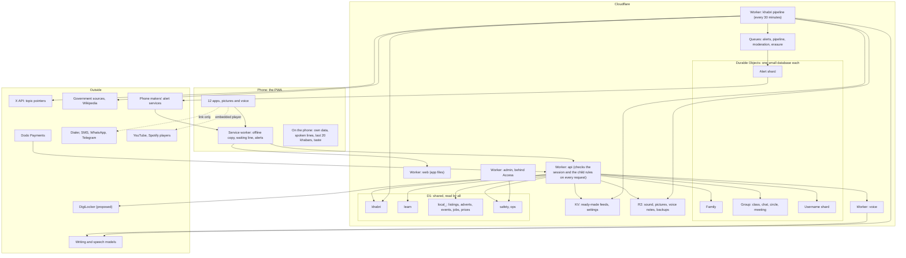

> DRAFT, stopped on 2026-11-26. sumeet: this cannot be written until each of the ten remaining apps is designed. Not agreed, not for guidance. Per-app parts are guesses from the design map.

# CubeGullak: high-level design

Written 2026-11-26. One design for all twelve apps, because the backend is shared. It meets `requirements.md` and
`privacy.md`. Choices made here are logged in `../tradeoffs.md` under [hld]. Cloudflare limits and prices were checked
on 2026-11-26.

## 1. The idea in five lines

1. The phone does as much as it can: the app, the spoken lines, the last khabars and the person's own data live on it.
2. Each **family** has its own small database (a Durable Object). A family is one adult's account plus the child
   profiles that adult made. Nothing private about a family is stored anywhere else.
3. Each **group** (a class, a chat, a discussion circle) has its own small database of the same kind.
4. Things everybody reads (khabars, lessons, listings, adverts, events) sit in shared databases (D1), cut by area, and
   are served from Cloudflare's cache.
5. Growth adds more small databases. No part gets bigger as people join.

## 2. Picture

## 3. Why Durable Objects for families

Checked limits: a D1 database holds at most 10 GB and an account gets 10 lakh of them, so one D1 per family cannot reach
60 crore families. Durable Objects with SQLite have no limit on how many, 10 GB each, and no limit on total storage. One
object handles about 1,000 requests a second, far more than a family or a class needs. So:

- Private, per-family and per-group data: Durable Objects.
- Shared, read-mostly data: D1, cut so no database nears 10 GB.

All storage is reached through one small layer in the code (`store`), so a family could be moved to another store if a
law ever requires storage in India (`privacy.md` section 6).

## 4. Parts

| Part | Kind | Job |
| :--- | :--- | :--- |
| `web` | Worker with static files | Serves the PWA (the Next.js app in `apps/`, built for Cloudflare with OpenNext), the landing page, spoken lines. |
| `api` | Worker | Every call from the phone. Checks the signed session, applies the child rules, then talks to the right family, group or database. |
| `Family` | Durable Object class | One per family. All private data. Also rings reminders with its alarm. |
| `Group` | Durable Object class | One per class, chat, circle or meeting. Members, posts, messages. Live updates by WebSocket that sleeps when idle. |
| `UsernameShard` | Durable Object class | 4,096 shards by hash. Keeps usernames unique and maps a username to a person. |
| `AlertShard` | Durable Object class | Alert addresses grouped by language and area, so one queue message sends many alerts. |
| `khabri-pipeline` | Worker with a timer and a Workflow | Makes khabars (section 8). |
| `voice` | Worker | Speech to words and words to speech, behind one door so the vendor can change. |
| `admin` | Worker behind Cloudflare Access | Moderation, hand-picking kids' videos, verified marks, grievances. |
| D1 `khabri` | Database | Khabars in 12 languages, sources, pipeline runs. |
| D1 `learn` | Database | Courses and lessons in 12 languages. |
| D1 `local_<PIN3>` | About 800 databases, one per first three digits of the PIN code | Listings, adverts, events, jobs, mandi prices for that area. |
| D1 `safety` | Database | Reports, moderation actions, verified marks, blocks. |
| D1 `ops` | Database | Grievances, erasure requests, notice versions, payment events, breach log. |
| KV `feed` | Key-value | The ready-made Khabri feed for each language, variant and area. |
| KV `config` | Key-value | Variant settings (names, which apps are on, safety rules), feature switches. |
| R2 `public-media` | Bucket | Khabar sound and pictures, lesson media, spoken lines. Cached worldwide. |
| R2 `private-media` | Bucket | Voice notes, profile pictures, listing pictures. Reached only through `api`. |
| R2 `backups` | Bucket | Daily copies of D1, logs kept one year. |
| Queues | `alerts`, `pipeline`, `moderation`, `erasure`, each with a dead-letter queue | Work that should not make a person wait. |

### What Terraform creates, and what Wrangler does

Terraform (lasting things): the zone and DNS for cubegullak.com; the D1 databases (`khabri`, `learn`, `safety`, `ops`,
and `local_<PIN3>` from a list); the three R2 buckets with their lifecycle rules; the two KV namespaces; the eight
queues; the Access application and policy for `admin`; firewall and rate-limit rules; a Turnstile widget; Logpush to
`backups`; the Workers' custom domains; the secrets store.

Wrangler (deploys): the Worker code, the Durable Object classes and their migrations, bindings, timers, the Workflow,
database schema migrations.

Staging is a second copy of everything with a `-staging` suffix and only a handful of `local_` databases.

## 5. Identity and sessions

- The passkey is the account. When it is made, the phone stores the family id and person id inside the passkey itself
  (the user handle). At sign-in the phone returns them, `api` asks that Family for the public key and checks the
  signature. No table of all users is ever searched.
- After the check, `api` gives a signed session (30 days, renewed on use). It names the family, the person, the kind
  (adult, teen, kid) and the device. Any Worker can check it without a lookup.
- Entering or leaving a child's profile, changing variants, paying, changing consent and erasing need a fresh passkey
  check (the lock), not just a session.
- A person's public id is `family id + person number`, wrapped so it cannot be guessed. A scanned code never carries
  this id bare: it carries a signed pass that works once and dies in 5 minutes.
- Every request from a kid's or teen's session passes one rule table in `api` (from `config`) before anything else:
  which apps are on, who can be messaged, no ads, no adult actions.

## 6. Data model

### Inside one Family (private)

| Table | Holds |
| :--- | :--- |
| `family` | id, owner, PIN code, plan (ads or no ads until a date), created, last used |
| `person` | id, kind (adult, kid, teen), name, username, picture, language, birthday (optional), variants (up to three for an adult) |
| `passkey` | credential id, public key, device name, person |
| `device` | alert address, last seen |
| `consent` | person, purpose, notice version and language, given or withdrawn, when, by whom |
| `parent_check` | child, how the adult was verified, token reference, when (see `privacy.md` section 3) |
| `guardian` | child, guardian (a person in any family), added when, by whom |
| `child_control` | child, minutes each day, sleep time, apps on, time used per day (30 days) |
| `list_entry` | owner person, list (family, friends, work, trade, neighbours, class), the other person, their name and picture as last seen |
| `membership` | person, group id, role |
| `home` | person, tile order, kept on top, hidden |
| `reminder` | person, what (words or a voice note), when, repeat, who else may see it |
| `saved` | person, kind (khabar like, event, listing, lesson, job), reference, state (for the job tracker and lesson place) |
| `card` | person, work details: skills, business card (name, category, hours, place) |
| `taste` | adult only: a small copy of on-phone taste, for restore |
| `audit` | every change to a child's profile and every use of the lock |

`reach_me` (an optional mobile number and one app) is **not decided** and has no table yet.

### Inside one Group (shared by its members)

| Table | Holds |
| :--- | :--- |
| `group` | id, kind (class, chat, circle, meeting, hobby), name, maker, join code, rules (office hours, who can post, who can see) |
| `member` | person, role (teacher, student, parent, guardian, member, moderator), for a parent: which child |
| `message` | from, words or a voice note reference, when, state (shown, held, removed) |
| `post` | for a class: homework, speak to all; for a circle: a thread and its replies |
| `schedule` | for a meeting or class call: when, who |
| `report` | a pointer to the row in `safety` |

### Shared databases (public or run by us)

| Database | Tables |
| :--- | :--- |
| `khabri` | `khabar` (kind: khabar, song, video, day card; audience variants; age band; area; sources; time), `khabar_text` (per language: words, sound file), `pointer` (the X post id that led to a topic, nothing more), `run` |
| `learn` | `course`, `lesson`, `lesson_text` per language, audience variants |
| `local_<PIN3>` | `listing` (a copy of a business card, category, PIN, verified), `advert` (owner, picture and sound, PIN codes, variants, apps, budget, state), `event`, `job`, `price` |
| `safety` | `report`, `action`, `verified` (teacher, recruiter, payer, business), `block` |
| `ops` | `grievance`, `erasure`, `notice` (versions in 12 languages), `payment_event`, `breach` |

### Who sees what

| Data | The person | The owner (parent) | A guardian | A teacher | People in a list | Everyone | CubeGullak staff |
| :--- | :--- | :--- | :--- | :--- | :--- | :--- | :--- |
| An adult's profile and settings | Yes | | | | Name and picture | | Ids only |
| A child's profile | Picture, nickname, guardians | All, and changes it | Name and picture | Name and picture, if let in | | | Ids only |
| A kid's chats | Yes | Yes | Only their own chat with the kid | Only their own, and it goes to the parents | | | On a report |
| A teen's class chat | Yes | Yes | | Yes | Classmates | | On a report |
| A teen's other chats | Yes | Not the content (C) | | | Those in the chat | | On a report |
| Child control and time used | Sees the limits | Yes | | | | | No |
| Lists of people | Yes | A child's lists | | | Only that they are linked to you | | No |
| Reminders | Yes | A kid's | | | Only if shared | | No |
| Khabar likes, taste | Yes | | | | | | No (on the phone) |
| Class homework and speak to all | Yes | Yes, under the child | | Yes | Class members | | On a report |
| Other parents of a class | | Yes | | Yes | | | No |
| Discussion posts | Yes | | | | | Circle members | Yes, to moderate |
| Listing, business card, advert | Yes | | | | | Yes, by choice | Yes |
| Payment | Yes | | | | | | The Dodo record |

A teen's chats outside the class not being readable by the parent is Claude's choice, open to change (`tradeoffs.md`).

## 7. Main flows

**First run.** Landing, language, lock, notice and consent, PIN code, what you do, alerts, Home. At the lock, the phone
makes a passkey; `api` makes a new Family and stores the public key. The notice step is new (`privacy.md`).

**Sign in on a new phone.** The synced passkey returns the family and person ids; `api` checks the signature with the
Family; a session is given.

**Add a child.** The owner uses the lock. If this is the first child, the parent check runs (proposed: a DigiLocker age
token). The Family adds a `person` of kind kid or teen, a `consent` row and a `parent_check` row. The owner is the first
guardian.

**Add a guardian or join a list.** A shows a code; B scans it. The code is a pass signed by `api`. `api` writes one row
in A's Family and one in B's. For a guardian of a child, the owner's lock is asked first.

**Class.** A teacher makes a Group of kind class and gets a class code. A parent enters the code under the child and
uses the lock: this adds the child to the class and the teacher as a guardian of that child. A teen joins with the
parent's lock too. The Group applies the rules: office hours; a kid's class messages go to the parents; a teen's class
chat is visible to the teacher.

**Reading Khabri.** The phone asks for the feed for its language, variants and area. `api` returns the ready-made list
from KV, the same for everyone in that bucket, so it is cached. The phone orders the cards by its own taste. A like is
kept on the phone (and for adults copied into `taste`).

**A khabar alert.** The pipeline publishes; one queue message per AlertShard batch; each batch sends up to a few
hundred alerts to the phone makers' services. At most one alert per person per day.

**A reminder.** Saved on the phone and in the Family. The Family sets its alarm for the next one due and sends an alert
when it rings. The phone also rings it locally if it is awake.

**Hand-off.** A person's row opens a plain link (`tel:`, `sms:`, `wa.me`, `t.me`). Nothing passes through the backend.
Never offered in a kid's session. Where the number comes from is not decided.

**Remove ads.** The owner uses the lock and pays by UPI through Dodo. Dodo calls `api`; the message's signature is
checked and confirmed with Dodo; the Family's plan is set; a row goes to `payment_event`.

**Showing an advert.** `api` picks from the adverts of the person's area, variants and the app being used. No personal
history is used. Never on Home, never in Khabri, never on a player card, never in a child's session, never for a
no-ads family. Counts go to Analytics Engine as totals.

**Erasing.** The owner uses the lock. `api` puts a job on the `erasure` queue: delete the Family object, remove its rows
from groups, lists of other families (they keep nothing but a "left" mark), listings, adverts, files in R2 and the
username. Done within 7 days; backups age out in 30.

**Offline.** The service worker serves the app and saved data. Changes wait on the phone with a number and time; when
the network returns they are sent in order. The Family keeps the latest change per field.

## 8. The Khabri pipeline

Runs every 30 minutes as a Workflow, so each step can retry on its own.

1. **Pointers.** Read new posts from the chosen X handles through X's API. Keep only the post id and the topic it points
   to. The post is never rewritten, translated or summarised.
2. **Pick.** Choose topics worth telling: Indian, calm and joyful, and for which a permitted source exists.
3. **Facts.** Gather facts only from government press releases, open government data and Wikipedia. Fetched words are
   material, never orders to the writer.
4. **Write.** One khabar in very simple English, easiest part first, time and place first, sources listed.
5. **Check.** A second pass compares each fact with the sources. A khabar that fails is dropped.
6. **Audience.** Mark which variants, which age band (kids, teens, adults) and which area it fits. Kids' songs and
   videos are not made here: they are hand-picked in `admin`.
7. **Languages.** Translate into the other eleven languages and make the sound for all twelve. Save words in `khabri`
   and sound in `public-media`.
8. **Publish.** Rebuild the affected feeds in KV. Queue alerts.

Practical items (mandi prices, job alerts, scheme dates) come from open government data straight into `local_` and
appear in the feed as cards. The old four-level writing is replaced by step 4 (`backlog.md`).

## 9. Security and operations

- All traffic is HTTPS. Storage is encrypted by Cloudflare. Voice notes and private pictures are reached only through
  `api`, by short-lived links.
- Secrets (the session key, X, Dodo, model and alert keys) are in Cloudflare's secret store.
- Limits per session, per address and per area on every write and search. Turnstile on odd traffic.
- Logs hold ids and actions, never names, message text or speech. They go to `backups` and are deleted after one year.
- Durable Objects can be restored to any point in the last 30 days. D1 is copied daily to `backups` and also has its own
  30-day time travel.
- One dashboard: requests, errors, speed against the targets, queue backlogs, cost per active person.
- Deploys go to staging, then to 1%, then to all.

## 10. Each app on this design

| App | Reads | Writes | Notes |
| :--- | :--- | :--- | :--- |
| Khabri | KV `feed`, `khabri`, `public-media` | Likes on the phone; `taste` for adults | Children: no server taste. X embeds for adults only. |
| Learn | `learn`, `public-media` | `saved` (lesson place) | Kids: games, no scores. Class homework comes from the class Group. |
| Earn | `local_` `job` and `price` | `saved` (tracker), `card` (skills) | Kids: a parent-run piggy goal in the Family only. Teens: no paid work. |
| Reminders | Family `reminder` | Same | Rings by the Family's alarm. Fully offline. |
| Hobbies | `learn` (activities), Groups of kind hobby | `membership` | Teens' groups are moderated. |
| Meetings | Group `schedule`, lists | Same | Adults' calls hand off. Class calls and kids' calls wait for in-app calls (Cloudflare Realtime). |
| Messages | Lists, Groups of kind chat and class | `message` | One-to-one adult talk hands off. In-app: kids with guardians, and groups. |
| Discussions | Groups of kind circle, one per topic, district and language | `post` | Off for Kids. Teens: posts are checked first. |
| Events | `local_` `event` | `saved` | A parent books for a kid. |
| Yellow Pages | `local_` `listing`, by category and voice search | `listing` from `card` | Hidden for Kids. Search looks at the home area and its neighbours. |
| Advertise | `local_` `advert` | `advert`, checked through the `moderation` queue before showing | Hidden for Kids. Teens: posters for school events only. |
| Me | The Family | The Family | The lock for child profiles, variants, payment, consent, erasing. |

## 11. Build order

1. Terraform for the lasting resources; move the web app from Vercel to the `web` Worker.
2. `api`, Family, passkey check, sessions, the notice and consent step, sync of what is on the phone today.
3. Child profiles, child control, the parent check, codes and lists, the class Group.
4. The Khabri pipeline, twelve languages, alerts.
5. Messages (kids and groups), then the other apps one at a time on `local_` and Groups.

## 12. Open

- How the parent is verified (waiting on sumeet; `privacy.md` section 3).
- Reach me (waiting on sumeet; `shell/backlog.md`).
- Speech vendor and the writing model (`shell/backlog.md` "Price of voice").
- In-app calls for kids and classes.
- Account recovery.
